<!-- TILES:START -->
<!-- TILES:END -->

### What I do

I build AI systems and production software for environments where being wrong is expensive. On the research side that means multimodal deep learning and probabilistic reasoning pipelines; on the product side, platforms with real guarantees around correctness, reproducibility and trust.

No hype. Just systems that work.

### Now

**Presage, founder and CEO.** An AI-native semantic data platform, starting with shipping logistics.

**Adventra Labs, founder and CEO.** An independent AI research company building verifiable, safety-first systems. The flagship is **NOVA**, a 1.233B-parameter cognitive architecture with Dirichlet evidential uncertainty gating, vacuity-gated continual learning and causal latent dynamics. [Stage 0 is on Zenodo](https://doi.org/10.5281/zenodo.20562861); Stage 1 is fully implemented across ~28 files and ~9,500 lines.

**NSF ExLAIM REU, NC State GIC Lab, Summer 2026.** One of five selected nationally. I built core parts of **MerryQuery**, an LLM-powered educational platform used in K-12 and university computing courses: pgvector citation grounding, security hardening (rate limiting, reCAPTCHA v3, brute-force lockout), an admin dashboard with live database health probes, append-only chunk storage, and the quiz and practice assessment system.

### Selected work

| Project | What it is | Stack |
|---|---|---|
| **NOVA** | 1.233B-parameter cognitive architecture with evidential uncertainty, continual learning and causal latent dynamics | PyTorch, FastAPI, Pythia 1.4B |
| **VexDB** | C++20 parallel HNSW vector database: 9.5x insert throughput over a naive baseline, 7x lower latency than hnswlib at 14 threads, 100% recall@10 | C++20, SIMD, lock-free structures |
| **VERITAS** | Deterministic AI evaluation engine: 9 microservices, SHA-256 audit chains, 427 tests | Python, FastAPI, PostgreSQL |
| **MerryQuery** | Educational LLM platform for K-12 and university courses, with citation grounding, security hardening and admin tooling | Flask, PostgreSQL, React, pgvector |
| **LUMEN** | ~9M-parameter transformer on a from-scratch NumPy autograd engine, with mechanistic interpretability tooling | NumPy, custom autograd |
| **Oral carcinoma detection** | Co-authored preprint: an ensemble ViT and ResNet model for cancer detection ([Zenodo](https://doi.org/10.5281/zenodo.20274795)) | PyTorch, ViT, ResNet |

<!-- REPOS:START -->
<!-- REPOS:END -->

### Recognition

- **NSF ExLAIM REU**, one of five selected nationally, 2026
- **2nd place, Philly Codefest**
- **MetaCTF** placements
- Preprint on ensemble ViT and ResNet oral carcinoma detection
- NOVA Stage 0 architecture published on Zenodo

Building at <a href="https://labs.faazmohamed.com">labs.faazmohamed.com</a>. Writing at <a href="https://faazmohamed.com">faazmohamed.com</a>. Cards redraw every morning from my contribution data.

